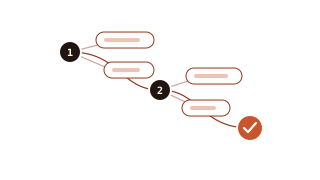
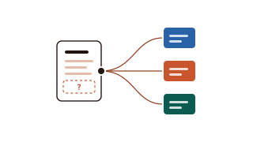
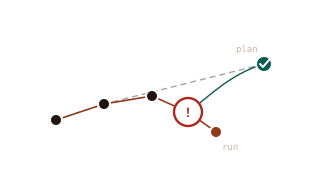

<section class="afs-section afs-section--intro" id="what">
  

    <h2>What is on this site</h2>
    
Hand agents the work whose results can be checked cheaply. Every recipe states how to check its output.

  

  

    <article class="afs-feature-card">
      

        
      

      <a class="afs-card-title" href="recipes/">Recipes →</a>
      
One task per recipe: the steps, how to check the output, and known problems.

    </article>
    <article class="afs-feature-card">
      

        
      

      <a class="afs-card-title" href="skills/">Skill briefs →</a>
      
Copy a brief, give it to your agent, answer its questions about your institute, and get your own version of the skill.

    </article>
    <article class="afs-feature-card">
      

        
      

      <a class="afs-card-title" href="recipes/failures/">What went wrong →</a>
      
Errors reported with the recipes, and which recipe now prevents each one.

    </article>
  

</section>

<section class="afs-section afs-section--involved" id="involved">
  

    <h2>Contribute</h2>
    
The first recipes come from one centre. They get better when other groups test them.

  

  

    <article class="afs-involved-card">
      <a class="afs-card-title" href="about/contribute/#add-an-example">Add an example →</a>
      
You used a recipe in your group. Say what worked and what did not.

    </article>
    <article class="afs-involved-card">
      <a class="afs-card-title" href="about/contribute/#report-an-error">Report an error →</a>
      
An agent made an error others should know about. Names and details are removed by default.

    </article>
    <article class="afs-involved-card">
      <a class="afs-card-title" href="about/contribute/#contribute-a-skill">Share a skill →</a>
      
A new brief, or the local version you built from one.

    </article>
  

  
Also: <a href="guide/verifiability/">which work to give to agents</a> · <a href="guide/limits/">where to draw the line</a> · <a href="about/concept/">the idea behind the site</a>.

</section>

